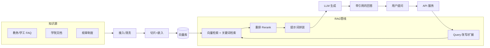

# 校园知识库项目方案（RAG 架构）

> 体裁：方案提案（workplace.proposal） · 状态：探索稿，待决策者评审
> 决策者：项目负责人（待具名） · 决策时点：建议 2 周内评审 · 文档版本：v0.1

---

## 1. 决策入口（结论先行）

**核心推荐**：基于 **自建 RAG 架构**搭建校园知识库，先做 **3 个月 MVP 试点**，覆盖 1–2 个学院或 1 类高频问答场景，验证检索精度与运营成本后再决定是否扩展至全校。

**本次需决策者批准的三件事**：
- 方向：是否采纳"自建 RAG + MVP 试点"路线（而非云平台托管或维持现状）。
- 资源：3 个月试点所需人力与基础设施预算（详见 §6）。
- 范围：试点学院 / 场景清单与数据接入授权。

> 本稿为探索稿：决策者具名、预算上限、试点范围、知识源清单尚未确定，相关数字以范围估算呈现，待评审时收敛。

---

## 2. 改变理由与不行动基准

### 2.1 现状问题（基于通用校园场景的假设）
- 校园信息分散在多个系统（教务、学工、后勤、各学院网站），师生检索效率低。
- 常见问答依赖人工值守（辅导员、行政老师），重复问题占用人力。
- 缺少统一的自然语言问答入口，无法复用大模型能力。

> 以上为通用痛点假设，**未做校内调研**；评审前需补 1 次小范围用户访谈（建议 10–15 人）以校准真实需求权重。

### 2.2 不行动基准（维持现状）
- 成本：接近 0 新增投入。
- 代价：检索效率与人力占用问题持续；后续每新增一个系统，人工答疑成本线性增加。
- 适用判断：若校方当前无明确的"AI 问答/统一检索"诉求，不行动是合理选择。

### 2.3 最小变化基准（仅文档数字化 + 关键词检索）
- 用现有工具（如 Elasticsearch 或数据库全文检索）做关键词搜索。
- 成本低、可控；但无法处理语义近似问句（如"宿舍几点熄灯" vs "寝室门禁时间"），与"AI 问答"目标存在本质差距。

---

## 3. 目标与成功标准

| 维度 | 目标 | MVP 成功标准（3 个月） |
|-|-|-|
| 检索精度 | Top-5 命中相关段落 | 人工标注集 Top-5 命中率 ≥ 80% |
| 回答质量 | 引用来源、可溯源 | 幻觉率（无据回答）≤ 10% 人工抽检 |
| 覆盖 | 试点范围知识源 100% 接入 | 接入 ≥ 1 类核心知识源（如教务/学工 FAQ） |
| 响应时延 | 首字 < 3s，完整 < 8s | P95 达标 |
| 使用量 | 试点用户真实使用 | 日活 ≥ 50（试点范围内） |

> 量化标准为建议值，评审时与决策者确认是否调整。

---

## 4. 候选方案同口径比较

| 维度 | A. 自建 RAG | B. 云厂商 RAG 平台 | C. 关键词检索（最小变化） |
|-|-|-|-|
| 范围 | 全链路可控：数据接入、切片、检索、生成 | 托管 RAG 流水线，配置为主 | 仅关键词检索，无生成 |
| 3 个月可达成 | MVP 可行 | MVP 可行 | 可行，但达不到 AI 问答目标 |
| 一次性成本 | 中（架构设计 + 开发） | 低（配置为主） | 低 |
| 月度运营成本 | 中（向量库 + LLM API） | 中高（平台按量计费） | 低 |
| 可控性 / 数据主权 | 高（数据不出校） | 中（依赖云厂商，数据需上云） | 高 |
| 扩展性 | 高（可替换模型 / 向量库） | 中（受平台能力约束） | 低（语义能力天花板低） |
| 主要风险 | 工程复杂度、LLM 幻觉 | 数据合规、供应商锁定 | 目标错配（无法实现语义问答） |

> 同口径说明：三选项均按"3 个月内 MVP"为时间口径，成本与扩展性按校内可获取资源估算，未含招标流程差异。

---

## 5. 推荐与代价

**推荐 A（自建 RAG）**：在数据主权、可控性、与目标匹配度上最契合校园场景；MVP 阶段工程量可控，后续可平滑替换组件。

**放弃 B（云平台）的代价**：节省 1–2 周配置时间，但校园数据（含学生信息）上云存在合规审批成本，长期被平台锁定，与"可控"诉求冲突。

**放弃 C（关键词检索）的代价**：节省 60%+ 开发量，但无法实现语义问答这一核心目标，等于推迟而非解决问题。

---

## 6. 资源与交付（3 个月 MVP）

### 6.1 人力（范围估算）
| 角色 | 投入 | 说明 |
|-|-|-|
| 后端 / 架构 | 1 人 × 3 月 | RAG 管线、API、向量库接入 |
| 数据 / 内容 | 0.5 人 × 1 月 | 知识源梳理、清洗、标注集 |
| 前端（可选） | 0.5 人 × 1 月 | 问答入口页面 |
| 评审 / 决策 | 项目负责人 | 阶段评审 3 次 |

> 若团队仅 1 人全栈，MVP 范围需收窄至"API + 命令行/简单页面"，不含前端。

### 6.2 基础设施与 API 成本（月度，范围估算）
| 项 | 估算 | 备注 |
|-|-|-|
| 向量库 | ¥0–500/月 | 小规模用 Chroma/Weaviate 自托管；规模化用云托管 |
| LLM API | ¥200–2000/月 | 取决于模型与调用量，DeepSeek/通义等国产模型较便宜 |
| 应用服务器 | ¥200–500/月 | 1 台 2C4G 起步 |
| 合计 | ¥400–3000/月 | MVP 阶段下限；规模化需重新估算 |

> 成本估算基于公开定价与常见用量假设，**未经实际压测**；评审时确认预算上限后收敛。

### 6.3 里程碑
| 里程碑 | 时点 | 交付 |
|-|-|-|
| M1 架构与数据源梳理 | 第 4 周 | 架构图、知识源清单、标注集 v1 |
| M2 RAG 管线打通 | 第 8 周 | 端到端问答可用（API + 简单界面） |
| M3 试点验收 | 第 12 周 | 精度/时延达标报告、试点用户反馈、扩展决策建议 |

---

## 7. 风险与未知

| 类别 | 风险 / 未知 | 应对 |
|-|-|-|
| 数据 | 知识源分散、质量参差、格式不一 | 梳理清单优先级，先接 1 类高频源 |
| 合规 | 学生个人信息上云 / 出校 | 自建方案数据不出校；仍需法务/信息中心确认 |
| 模型 | LLM 幻觉、引用失真 | 强制引用来源 + 置信度阈值 + 人工抽检 |
| 成本 | LLM API 用量不可控 | 设调用上限、缓存、按学院配额 |
| 运营 | 知识更新机制缺失 | 设内容 owner 与更新周期 |
| 未知 | 决策者具名 / 预算上限 / 试点学院范围 / 知识源清单 | 待评审收敛 |

---

## 8. 决策入口（评审待确认项）

评审会上需决策者明确以下事项，否则稿保持 `blocked`：

1. 是否采纳 A（自建 RAG + MVP）方向？
2. 3 个月试点预算上限？
3. 试点学院 / 场景与数据接入授权？
4. 是否允许学生个人信息进入知识库（影响数据治理设计）？
5. 试点通过后的扩展决策时点与负责人？

---

## 附录 A：RAG 系统整体架构（示意）

**层级说明**：
- 用户接入层：问答入口（Web / 小程序 / API）。
- 服务层：API、会话管理、配额与缓存。
- RAG 管线：Query 处理 → 混合检索 → 重排 → 提示词拼装 → LLM 生成。
- 数据层：知识源接入 → 清洗 → 切片 + 嵌入 → 向量库。
- 治理层（未画）：权限、审计、内容更新。

> 该架构为 MVP 基线，组件（向量库、LLM、嵌入模型）均可独立替换。
